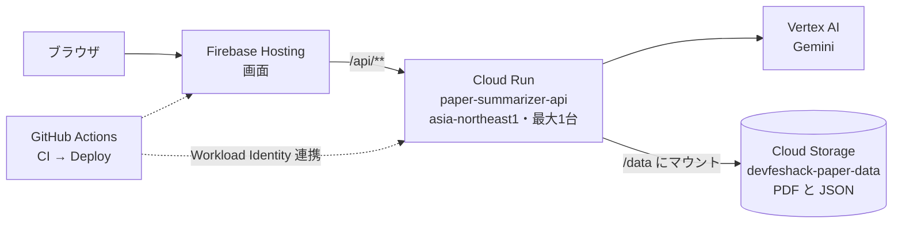
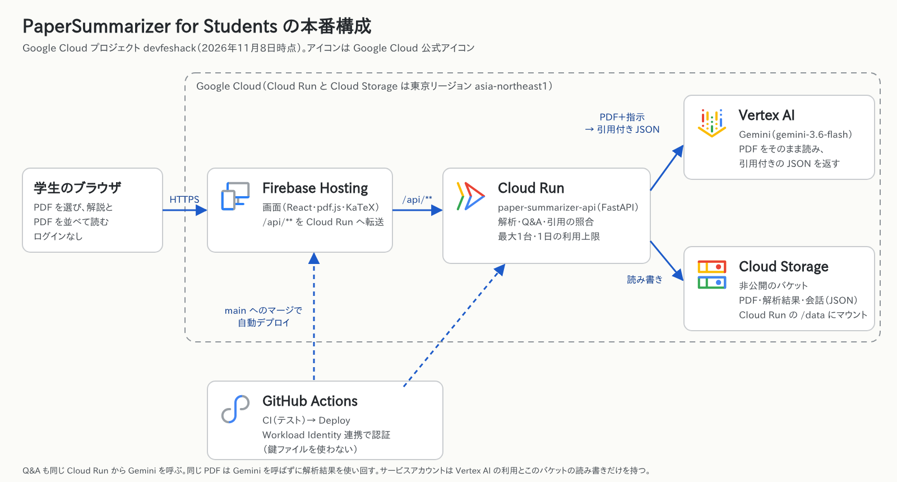

# PaperSummarizer for Students 仕様書

最終更新: 2026-11-08（main `ec466a9` 時点）

## 概要

英語論文のPDFを1本読み込むと、Geminiが論文を解析し、学生は「知る → 追う → 疑う」の3段階で読み進める。応募カテゴリは「教育」で、対象は研究室に配属されたばかりの学部4年生から修士1年生。

このアプリは要約ツールとして作らない。要約を渡して終わりにせず、解説のすべてに論文のページを付けて原文へ戻れるようにする。最後は学生自身が論文の弱点を考える。目指すのは、学生が原文を自分で読めるようになることだ。

画面は左右2分割で、左にPDF、右に解説を置く。境目をドラッグすると幅を変えられる。

公開URLは <https://devfeshack.web.app> で、バックエンドをCloud Run、フロントエンドをFirebase Hostingに置いている。デプロイの手順と設定の理由は [paper-summarizer/DEPLOY.md](../paper-summarizer/DEPLOY.md) にある。

## テーマの解釈

テーマ「Own the Why, Build with Intent.」を、このアプリでは「学生がAIの解説を鵜呑みにせず、原文を根拠に自分で判断できるようにする」と解釈する。キックオフ資料は、AIの提案を鵜呑みにせずPros/Consを比べ、選んだ理由を自分の言葉で語る力を求めている。論文を読む学生にとって、その力が試されるのは輪講で「この手法の弱点は？」と聞かれたときだ。

テーマは製品と開発の両方で実践する。

| 場面 | Own the Why | Build with Intent |
| --- | --- | --- |
| 製品（学生の体験） | AIの解説には必ずページと原文の引用を付け、学生が原文で確かめられるようにする。Step 3では、解説を開く前に自分の考えを書かせる | 「論文の記述」と「AIの指摘（要検証）」を分けて表示し、AIの推測を論文の主張のようには見せない |
| 開発（チームの判断） | PDFの渡し方や保存先を複数案で比べ、採用した案と捨てた案を理由とともに記録する（「技術構成と選定理由」の節） | MVPを「アップロードからStep 1〜3とQ&Aが根拠付きで動く」1本道に絞り、周辺機能はその完成度を下げない範囲で足す |

提出ドキュメントで必須の「AIをどの場面でどう使ったか」も、この表の開発の行と同じ考え方で書く。

## 対象ユーザーと課題

主な対象は、論文を読む訓練をまだ受けていない研究初心者。熟練した研究者向けの要約ツールはすでにあるが、初心者のつまずき方には合っていない。

メインペルソナは佐藤さん（情報系の学部4年、研究室配属3か月）。来週の輪講で、Transformer系の英語論文（12ページ、数式20個、図表8点）を15分で発表する。Abstractを読むだけで1時間かかり、汎用のチャットAIの要約は論文のどこに書いてあるかが分からない。サブペルソナは、日本語も英語も第二言語の修士1年の留学生と、他分野の論文を読む学生（医療系の学生が機械学習の論文を読むなど）。

| つまずき | 既存の手段で解けない理由 | 対応する部分 |
| --- | --- | --- |
| 何を知らないか分からず、頭から読んで力尽きる | Abstractや要約を読んでも、足りない前提知識が見えない | Step 1 前提知識マップ |
| 「Fig. 3参照」で図に飛ぶと、本文のどこに戻るか見失う | 翻訳ツールやテキスト抽出では図が落ちる | Step 2 図表連動ウォークスルー |
| 数式の記号の定義が数ページ前にあり、意味を追えない | 汎用AIは式を言い換えるだけで、定義の箇所を示さない | Step 2 記号表 |
| 内容は追えても、「弱点は？」と聞かれると答えられない | 要約ツールは論文の主張を言い換えるだけで、限界や代替案を示さない | Step 3 批判的思考チェック |
| AIの要約を信じてよいか判断できない | 汎用チャットは出典のページを返さない | 全Stepの根拠チップと常設Q&A |

課題の裏付けとして、研究室や同期10人ほどに「論文1本を読むのにかかる時間」と「止まる箇所」を聞くアンケートを取る（Issue #20、予定の11月7日を過ぎたが未完了）。

## 利用の流れ

学生は次の順に進む。Step 1の結果ができた時点で画面に出るので、全部の解析が終わるまで待たなくてよい。

1. アップロード画面で解説の言語（日本語／English）を選び、論文のPDFをドロップする。説明のレベルは学部生向けに固定している。前に読んだ論文は「これまでの論文」から続きを開ける
2. Step 1（知る）で、前提知識の概念を「知っている／知らない」で仕分ける。知らない概念にだけ説明が出る。3行要約と読む順番もここでつかむ
3. Step 2（追う）で、手法の流れを段階ごとに進む。進めるたびに左のPDFが該当ページへ移り、根拠の文が強調される
4. Step 3（疑う）で、問いに対する自分の考えを書いてから、Pros/Cons・限界・代替案と「輪講で聞かれそうな質問」を開く
5. どのStepからでも、下のQ&Aで質問できる。回答のページのチップを押すと、PDFのそのページが開く

## 機能一覧

MVP（F-01〜F-06）は本番のURLで動いている。e2eテスト（Playwright、デモモード）がアップロードからStep 1〜3、Q&Aまでを通し、本番ではBERTの論文（16ページ）で解析が最後まで終わることを確かめた。

| ID | 機能 | 内容 | 優先度 | 状況 |
| --- | --- | --- | --- | --- |
| F-01 | PDFアップロード | ドラッグ&ドロップ。テキストを含むPDFのみ。同じPDFは再解析せず結果を使い回す（解析の形を変えたときは版を上げ、古い版の結果は使い回さない） | MVP | 完成（20MB／100ページまで）。署名付きURLでのCloud Storageへの直接アップロードは未着手（#6） |
| F-02 | 前提知識マップ（Step 1） | 概念の依存グラフ、知っている／知らないの仕分け、3行要約、読む順番 | MVP | 完成。概念を必須・推奨・発展に分けて表示を切り替えられ、論文に出てくる概念は原文の引用を照合して根拠ページへ移動できる。論文に出てこない前提は「AIの推定」として分け、論文の概念から2段までに限る（#64）。「知らない」にした概念は、依存関係のトポロジカル順で「学ぶ順番」を出す。「知っている」にした概念はブラウザに覚え、次の論文で同じ名前（日本語名の括弧の英語名でも照合）の概念を最初から仕分け済みにする（#66）。辞書と前提知識グラフで求める方式（#56）は検討中。「先に読むとよい論文」（#65）として、論文の参考文献から手法のもとになっている論文を0〜5本、読む順番・理由・本文で引用している箇所の根拠（原文と照合し、できなければ「未確認」）付きで出す。外部のAPIは使わず、リンクはタイトルでの検索（Google Scholar）と、参考文献に書かれていれば DOI・arXiv（URLはフロントが固定のホストで作る）。Semantic Scholar での絞り込みは締め切り後。概念が依存でつながるようプロンプトで指示し、孤立した概念の数と依存の最大の深さをサーバーのログに残す（#107） |
| F-03 | ウォークスルー（Step 2） | 手法を段階に分けて解説し、進めるとPDFの根拠箇所を強調する | MVP | 完成。手法の流れ図（入力→処理→出力のノードと矢印）を段階と同じコマ割りで1コマずつ進められる。Geminiには図のデータ（JSON）だけを出させ、図の型は画面側で持つ（#28、#29）。ノードとコマの根拠も照合する。分岐・合流する経路をそのまま辺で表し、段階（事前学習と微調整など）はノードの group で分けて、図では段階ごとの帯にまとめる（#107） |
| F-04 | 図表・数式の連動表示（Step 2） | 図の読み方、数式の記号表と定義ページ（KaTeX表示） | MVP | 完成。式のカードに「この式に必要な前提」を出してStep 1の概念へ移動でき、Step 1の概念からは「この概念を使う式」へ移動できる（#67）。式の描画に失敗したときは、PDFのそのページの画像と「PDFで確認」を出す（#14） |
| F-05 | 批判的思考チェック（Step 3） | 先に自分の考えを書かせ、「論文の記述」と「AIの指摘（要検証）」を分けて示す | MVP | 完成 |
| F-06 | 根拠付きQ&A | どのStepからでも質問でき、回答にページと「論文外の一般知識」の区別を付ける | MVP | 完成。ストリーミング表示は未着手（#15） |
| F-07 | 処理進捗の表示 | Stepごとに結果が届き次第表示する | Should | 解析中はServer-Sent Events（GET /api/papers/{id}/events）で進捗を受け取り、最初の知らせが5秒以内に届かない・エラーになったときは1.5秒ごとのポーリングに切り替える（どちらでも同じ表示）。Geminiはストリーミング(generate_content_stream)で呼び、Stepごとの段階（読込・執筆・照合・完了）、書いた文字数、経過時間を「Step 1：解説を書いています（約1,200字・18秒）」の形で出す。進捗はプロセス内に持ち、heartbeatの書き込みに相乗りして要約だけ記録のprogressに入れる（別サーバーや引き継ぎ後も大まかに出せる）。SSEは最長50秒（Firebase Hostingのrewriteの約60秒の上限より短くする）でサーバーが閉じ、画面は3秒待って再接続する（10秒未満で閉じる接続が3回続いたらポーリングに切り替える）。同時接続は20本まで（超えたら429で、画面はポーリングに戻る）。Firebase Hosting経由でSSEが逐次届くかは本番で未確認（ためる場合はポーリングが受ける）。Step 2とStep 3はStep 1の結果だけを使うので同時に生成する。解析中は10秒ごとに記録へ生存の印（heartbeat）を書き、Cloud Runのインスタンスの入れ替えなどで解析が止まって45秒以上印が更新されないときは、論文の取得・一覧のときに別のプロセスが続きから引き継ぐ（最大3回。超えたら失敗にして「再実行」に任せる。引き継ぎは1日の解析の上限に数えない）。Firestoreのリスナーへの置き換えは未着手（#9） |
| F-08 | 出力言語の切替 | 日本語／英語 | Should | 解説の言語（日本語／English）はアップロード時に選べる。説明のレベルは学部生向けに固定した。対象が配属されたばかりの学部4年から修士1年で、読む前に選ぶ手間を減らし、同じPDFを二重に解析しないため。論文を開いたあとの言語の切替は未着手（#16） |
| F-09 | 履歴・再訪 | 過去の論文とStep 3で書いた考えを一覧する | Nice-to-have | 論文の一覧と「続きから読む」は完成。一覧には、そのブラウザでアップロードした論文だけが出る。書いた考えはブラウザにだけ保存し、一覧には出ない。一覧は画面に収まる件数だけ出し、残りは「すべて表示」で開く。自分の論文は「削除」で消せる（解析結果・質問・PDF も消え、元に戻せない） |
| F-10 | 輪講スライド骨子の出力 | Step 1〜3から発表の構成案をMarkdownで出す | Nice-to-have | 決勝進出後に検討（#27） |
| F-11 | 複数論文の比較 | 2本の手法と結果を表で並べる | Nice-to-have | 決勝進出後に検討（#27） |
| F-12 | 誤り探しモード | AIの解説にわざと誤りを1〜2文混ぜた5文ほどの問題を、Step 1〜3とは別のタブで出す。学生は誤りだと思う文と根拠のページを答え、答え合わせで元の文と根拠ページを見る | Nice-to-have | 実装済み（#55）。誤りは引用を照合できたStep 2・3の項目からだけ作り、変えた語句が引用の該当部分と食い違うことをサーバーで確かめてから出題する。答えは回答するまでブラウザに送らない。問題は論文ごとに保存し、作成は論文ごとの回数制限と1日の上限（`MAX_QUIZZES_PER_DAY`）に数える |
| F-13 | 確認モード | Step 1の「問題に答えて仕分ける」で、表示範囲のうちまだ仕分けていない概念（必須から最大6）を1概念1問の4択で確かめる（選択肢の1つは必ず「分からない」）。正解なら「知っている」、不正解か「分からない」なら「知らない」を、手で押したときと同じ経路で付ける | Nice-to-have | 実装済み（#94）。問題はボタンを押したときに作り、解析の形は変えない。論文に出てくる概念は解説に引用を付けてPDFと照合し、論文に出てこない概念は引用なしの「一般知識による問題」と表示する。選択肢の重複（正規化して同じもの）や正解の番号の不正はサーバーで弾く。答えは回答するまでブラウザに送らない。作成は論文ごとの回数制限と1日の上限（`MAX_CHECKS_PER_DAY`）に数える |

ログイン機能はMVPに入れていない。本人のデータの分離はFirebase Anonymous Authで行う予定（#10）。

次の拡張はIssueに起こしてあり、提出までに入れるかは残り時間で決める。

| Issue | 内容 |
| --- | --- |
| #30 | 図解の型を増やす（式の分解・図への注釈・道順表示・比較表）。流れ図（#28、#29）と同じく、Geminiにはデータだけを出させる |
| #62、#63 | 絵コンテ（JSON）で動く概念の解説アニメーションと、その動画への書き出し。PaperLensはライセンスの記載がないため、コードは使わず設計の考え方だけを参考にする。LLMが書いたコードは実行しない |
| #65 | 先に読むべき基礎論文を、引用の文脈から理由と根拠付きで示す（Semantic Scholar） |

## 技術構成と選定理由

論文1本（数万トークン）はGeminiのコンテキストに丸ごと入る。そこで論文を切って検索するRAGは採らず、PDFをそのままGeminiに渡す。図表と本文の対応が崩れず、実装も少なくて済む。弱点は毎回全文を送るコストで、Q&Aではコンテキストキャッシュを使って減らす予定（#11）。

| 判断 | 採用 | 捨てた案 | 理由 |
| --- | --- | --- | --- |
| PDFの渡し方 | GeminiへPDFをそのまま入力 | チャンク分割+RAG、テキスト抽出+一括要約 | 図表と本文の対応を保てる。数式も組版されたまま読める |
| 出力の形 | JSONスキーマで固定し、根拠（Evidence）にページと原文の引用を持たせる | 自由な文章で出させる | 引用をサーバーで照合でき、画面の部品にそのまま渡せる。ただし要約・概念・読む順番などには引用の欄が無く、根拠の空リストも型の上では通る |
| Geminiの呼び方 | Vertex AI | Google AI StudioのAPIキー | Cloud CreditがAI Studioには使えない。サービスアカウントで呼べばAPIキーを持たずに済む |
| 実行基盤 | Cloud Run | GKE、Compute Engine | 開発期間が約5.5日しかなく、運用の手間が最も少ない。使われていない間は0台になる |
| 提出時点の保存先 | Cloud RunにマウントしたCloud Storage（ファイルとして読み書き） | 先にFirestoreとCloud Tasksへ置き換える | ローカル版の保存処理を変えずに本番へ出せる。代わりにインスタンスを1台に固定する |
| 将来の保存先 | Firestore（状態・結果・会話）、Cloud Storage（PDF） | Cloud SQL | Stepごとの結果をリスナーで画面へすぐ届けられる（#6、#7、#9） |
| 将来の解析の非同期処理 | Cloud Tasks | Pub/Sub、同期処理 | 同時実行数の上限とリトライを設定だけで持てる（#8） |
| 将来の認証 | Firebase Anonymous Auth | Googleログイン必須 | 審査員がログインなしで試せ、本人のデータだけを見せられる（#10） |

フロントエンドはVite、React、TypeScript、pdf.js、KaTeXで作り、Firebase Hostingで配信する。バックエンドはFastAPIとgoogle-genaiで、引用の照合にpypdfium2（PDFium）を使う。モデルは環境変数で入れ替えられるようにしており、既定値は解析もQ&Aもgemini-3.6-flash（`GOOGLE_CLOUD_LOCATION=global`）。

### 今の本番構成

Firebase Hostingは `/api/**` をCloud Runへ転送する。Cloud Runは専用のサービスアカウント（`paper-summarizer-run`）で動き、持つ権限はVertex AIの利用と、このバケットだけの読み書きに限る。解析は応答を返したあとにバックグラウンドで続くので、CPUを常に割り当てている（`--no-cpu-throttling`）。

mainへのマージでCIが通ると、GitHub ActionsがCloud RunとFirebase Hostingへ自動でデプロイし、公開URLで動作を確かめる（CD）。GCPへは鍵ファイルを使わずWorkload Identity連携で入り、このリポジトリのmainブランチの `deploy.yml` からしかデプロイ用アカウントになれない。mainにブランチ保護は付けず、チームの約束として、mainへ直接pushせず、レビューとCIが通ったPRだけをマージする。

置き換えの予定は次のとおり。

| 今の本番 | 置き換え先 | Issue |
| --- | --- | --- |
| APIがPDFを受け取ってバケットに保存 | 署名付きURLでブラウザからCloud Storageへ直接アップロード | #6 |
| バケット上のJSONファイルに状態・結果・会話を保存 | Firestore | #7 |
| バックグラウンドスレッド（同時実行2） | Cloud Tasks + Cloud Runのワーカー | #8 |
| フロントのポーリング | Firestoreのリアルタイムリスナー | #9 |

提出用のGoogle Cloudアーキテクチャ図（#23）は、公式アイコンを使って作った（[PNG](architecture.png)、[SVG](architecture.svg)）。図は今の本番構成を描いており、上の置き換えが済んだら描き直す。

## AIの誤りへの対策と安全性

AIの解説は間違えることがある。その前提で、学生が誤りに気づける仕組みを組み込む。アップロード画面にも「ページを開いて原文で確かめながら読んでください」と書いている。

| 仕組み | 内容 |
| --- | --- |
| 引用の照合 | Geminiが返した引用を、サーバーでPDFから抽出した文と照合する。引用は20文字以上とし、英語の引用は4語以上で、単語の境界で照合する。10語以上の引用は先頭か末尾の6割が一致すればよい。示されたページの前後2ページを先に探し、無ければ全ページを探す。見つからなければ「未確認」と表示し、別のページで見つかればページを直す |
| 論文の記述とAIの推測の区別 | Step 3の各項目に「論文の記述」か「AIの指摘（要検証）」かを付け、2列に分けて表示する |
| 論文外の知識の明示 | Q&Aの回答ごとに、論文に基づくか「論文外の一般知識」かを表示する。論文に記載がなければそう答えさせる |
| 先に自分で考えさせる | Step 3は問いを先に出し、学生が考えを書いてから解説を開く |
| PDFや質問の中の指示文への対策 | システムプロンプトで、PDFの中の指示文には従わないよう指示する。Step 1の結果、会話の履歴、質問は、呼び出しごとに名前を変えるタグで囲んでGeminiに渡すので、中の文がタグを閉じて指示のふりをすることはできない。PDF本体はタグで囲まずに渡している |

データの扱いと安全性は次のとおりとする。

- 秘密情報は `.env` か環境変数でのみ渡し、リポジトリに含めない。本番はCloud Runの専用サービスアカウントでVertex AIを呼び、APIキーを置かない
- 「これまでの論文」の一覧には、そのブラウザでアップロードした論文だけを出す（ブラウザごとのランダムなIDで絞り、サーバーにはそのハッシュだけを残す）。論文のIDを知られると中身は見えるので、本人のデータの分離は#10で行う
- アップロードされたPDFは本人の学習にだけ使い、他の人への公開や共有の機能は作らない。バケットは非公開にしている。一定期間後の自動削除はまだ設定していない
- デモには、再利用できるライセンスの論文を使う。BERT（ACL Anthology N19-1423、CC BY 4.0）に決めた

### 費用の上限

このプロジェクトには予算アラートを設定していない（オーナーの判断）。そのため、アプリ側にサービス全体の上限を設けている。1日の上限は直近24時間の回数で数え、バケットに記録するので、インスタンスが入れ替わっても0に戻らない。記録の読み書きに失敗したときは、費用が出ないよう、その依頼を断る。

| 上限 | 値（本番） | 数えるもの |
| --- | --- | --- |
| 解析 | 1日10回 | 新しい解析と再解析。解析済みのPDFの使い回しは数えない |
| 質問 | 1日50回 | 質問（1回ごとにPDF全体をGeminiに送る） |
| 誤り探し | 1日10回 | 誤り探しの問題の作成（`MAX_QUIZZES_PER_DAY`。論文ごとは1分に3回）。アプリの既定は20回で、deploy.shが10回に下げる |
| 確認モード | 1日10回 | 確認問題の作成（`MAX_CHECKS_PER_DAY`、PDF全体を送る）。アプリの既定は30回で、deploy.shが10回に下げる。誤り探しとは別に数え、片方を使い切ってももう片方は止まらない。論文ごとは1分に3回 |
| アップロード | 1日100回 | 使い回しを含むアップロード |
| 質問（全体） | 1分に20回 | 全論文の合計 |
| 質問（論文ごと） | 1分に10回 | 論文ごと |
| 再解析（論文ごと） | 1分に3回 | 論文ごと |
| 同時アップロード | 3件 | 超えたら待たせずに断る |
| Cloud Run | 最大1台 | 保存先がファイルなので、同時に書き込ませない |

解析と質問の上限は審査期間に合わせて低くしてある。Geminiを止めたいときは、上限を0にして環境変数だけを書き換える（手順はDEPLOY.md）。

## 採点基準との対応

審査は8項目をそれぞれ0〜3点で評価し、合計24点で順位を決める。各項目に対して、このアプリが示すものと、提出までに残っていることを並べる。

| 審査項目 | このアプリで示すもの | 残っていること |
| --- | --- | --- |
| 1a Google技術が中核で機能しているか | GeminiがPDFをそのまま読み、Step 1〜3とQ&Aをすべて生成する。引用付きのJSONで返すので、画面の部品とPDFの強調表示に直接つながる。Cloud Run、Firebase Hosting、Cloud Storage、Vertex AIで本番が動いている | Firestore・Cloud Tasksへの移行（#6〜#9） |
| 1b Google技術を採用した理由が合理的か | RAGやテキスト抽出と比べてPDFをそのまま渡した理由を、「技術構成と選定理由」の表で説明する | 費用と方式の比較は済んだ（#12、[docs/evaluation.md](evaluation.md)） |
| 2a 課題解決の操作が一連の流れとして動くか | アップロードからStep 1〜3、Q&Aまでをe2eテストで通している。本番のURLでもBERTの論文で解析が最後まで終わる | 本番のURLでQ&Aまで通した操作の記録（#26） |
| 2b 対象ユーザーが目的を達成できるUI・UXか | 「知る→追う→疑う」の順に情報を増やす。知らない概念にだけ説明を出し、PDFと解説を常に並べて幅も変えられる。キーボードと読み上げ、スマホの幅にも対応した | 論文を開いたあとの言語の切替（#16）。アンケート回答者に触ってもらう |
| 2c 安全性・拡張性・保守性を見据えた設計か | 秘密情報をリポジトリに置かず、鍵ファイルなしでデプロイする。費用の上限を全体と論文ごとにかけている。保存層と解析器を分けているため、本番のサービスに差し替えやすい。CIでlint（警告もエラー）、フロントエンドの型チェック、カバレッジ80%以上、Dockerイメージの起動を確かめる | 匿名認証による本人のデータの分離（#10） |
| 3a 解決する課題が具体的か | 研究室配属直後の学生が輪講のために英語論文を読む場面と、5つのつまずきに絞っている | アンケートでの裏付け（#20） |
| 3b 機能が実際の課題解決に有効か | つまずきごとに対応するStepがあり、根拠のページで原文へ戻れる。本番の画面から解析したBERT（11月8日、thinkingをlowにし、pypdfium2に替えたあと）では、引用25件がすべてPDFの文と一致した | 評価済み（[docs/evaluation.md](evaluation.md)）。3本の論文で根拠の98.5%が本文と照合でき、テキストだけを渡す方式（93.4%）を上回った |
| 4a デモ・話の構成が分かりやすくインパクトがあるか | Step 3で学生が自分の考えを書き、AIの指摘と論文の記述を見比べる場面を、テーマとの接点として見せる | デモ動画とピッチスライド（#25）。デモ用論文（BERT）は本番で解析済み。APIが止まったときの代わりの表示は未対応（#21） |

採点外だが必須の「AIをどの場面でどう使ったか」と「開発で何を得たか」は、プロダクト説明ドキュメント（#22）に書く。

## 制約への対応

| ルール（キックオフ資料） | 対応 |
| --- | --- |
| カテゴリは医療・福祉、観光、教育、エンタメ、クリエイティブのいずれか | 教育 |
| 実行にApp Engine、Compute Engine、GKE、Cloud Run、Firebase App Hosting、Firebase Hostingのいずれかを使う | バックエンドをCloud Run、フロントエンドをFirebase Hostingに置いた（<https://devfeshack.web.app>） |
| メイン技術はGoogle技術。他社製品を前面に出さない | 生成AIはGeminiのみ。他社のLLM APIは使わない |
| Cloud Creditは1チーム$20で、AI Studioには使えない | GeminiはVertex AI経由で呼ぶ。予算アラートが無いので、アプリ側の上限とCloud Runの最大1台で費用を抑える |
| APIキーや秘密情報をリポジトリにコミットしない | `.env` はgitの管理外。本番はサービスアカウント、CDはWorkload Identity連携で認証し、鍵ファイルを作らない |
| 開発は11月5日10:00から。開始前のコードやPoCの流用は禁止 | リポジトリは11月5日以降にゼロから作った |
| 提出締切は11月10日19:00。以降はリポジトリが読み取り専用になる | 最終コミットは11月10日の午前中を目安にする（#26） |
| デプロイURLをRegional Day（11月14日）まで動かし続ける | 同じPDFは再解析せず結果を使い回し、クレジットの残額を守る。審査期間は待機インスタンスを1台にする。CDのデプロイは待機インスタンスの数を変えない |
| 提出物はGitHubリポジトリ、プロダクト説明ドキュメント、デモ動画、著作物利用シート、ピッチ用スライド | #22、#23、#24、#25。デモ動画は実際の動作をそのまま収録する |

非機能要件の目標は次のとおり。企画設計書の初期値で、本番で計測した値を並べる。

| 区分 | 目標 | 今の状況 |
| --- | --- | --- |
| Step 1の表示まで | 12ページの論文で30秒以内 | 本番でBERT（16ページ）が約19秒（thinkingをlowにする前は約30秒） |
| Step 1〜3の生成完了 | 12ページの論文で2分以内 | 本番でBERT（16ページ）が約56秒（lowにする前は約76秒） |
| Q&Aの最初の文字が出るまで | 3秒以内 | ストリーミングが未実装（#15）。Firebase Hostingを通すため、1回の応答は60秒が上限 |
| ファイルの上限 | 50MB／100ページ | 20MB／100ページ。PDFをリクエストに直接載せるため |
| デモ中の障害 | APIが落ちても解析済みの結果を表示する | 未対応。BERTの解析結果は本番に保存済みで、同じPDFは再解析せずに表示するが、APIが止まると画面に出せない。認証情報がないときはデモモードで動く（#21） |

使用量と費用は、Gemini APIの応答に付く使用量（usage_metadata）とCloud Monitoringで測った（11月8日、BERT 16ページ）。単価はVertex AIのgemini-3.6-flash、globalの2026年末までの価格で、入力100万トークンあたり$0.75、出力$3.75。考える量（thinking）も出力に数えられる。

| 操作 | thinking | 入力トークン | 出力トークン（うちthinking） | 時間 | 費用 |
| --- | --- | --- | --- | --- | --- |
| 解析1回（Geminiを3回呼ぶ） | モデルの既定 | 約3.1万 | 約1.2万（約6,200） | 約65〜76秒 | 約$0.068 |
| 解析1回（Geminiを3回呼ぶ） | low（今の設定） | 約3.1万 | 約6,600（0） | 約50〜56秒 | 約$0.048 |
| 質問1回 | モデルの既定 | 約9,400 | 約1,200（約800） | 約10秒 | 約$0.011 |
| 質問1回 | low（今の設定） | 約9,400 | 約700（約400） | 約6秒 | 約$0.010 |
| 解析済みのPDFの使い回し | なし | 0 | 0 | 約2秒 | $0 |

表の時間のうち、約50秒と約65秒は手元からVertex AIを直接呼んだ試験、約56秒と約76秒は本番の画面からの解析で測った。thinkingをlowにしても、引用の照合の結果は落ちなかった（試験で照合できた引用の数は、既定で19件中18件、lowで24件中23件。PyMuPDFのころの値）。pypdfium2に替えたあとの本番の解析では、25件すべてが照合できた。要約・前提知識・手法の段階・Pros/Consの内容も、読み比べて同じ水準だった。そこで既定をlowにした（環境変数 `THINKING_LEVEL` で変えられる）。

1日の上限（解析10回、質問50回）を毎日使い切っても1日約$1.0で、$20のクレジットは約20日もつ。2027年1月1日から単価は2倍になる。

11月8日の時点では、Cloud Monitoringの値を広い時間幅で合計したため、解析1回を約$0.16、質問1回を約$0.025と多めに見積もっていた。5分ごとに分けて見ると、上の表の値と合う。

## 未決事項

提出締切の11月10日19:00までに、次のことを決める。

- [x] Cloud RunとFirebase Hostingへのデプロイをどこまで作り込むか。まずCloud Run（保存先はマウントしたCloud Storage）に載せ、Firestore・Cloud Tasksへの置き換えは後に回した
- [x] デモに使う論文とそのライセンス。BERT（ACL Anthology N19-1423、CC BY 4.0）に決めた（#21）
- [x] 解析とQ&Aに使うモデル。gemini-3.6-flashのまま、考える量（thinking）をlowにした。解析1回約$0.048、質問1回約$0.010（#12）
- [ ] 本番でのファイル上限を20MBのままにするか、50MBに上げるか
- [x] 出力言語の切替（#16）を提出までに入れるか。アップロード時に選べるようにした。論文を開いたあとの切替は再解析が要るので入れていない
- [x] 説明のレベルの選択を残すか。対象が配属されたばかりの学生なので学部生向けに固定した。読む前の選択をなくし、同じPDFを二重に解析することも避けられる
- [x] PyMuPDFのライセンス（AGPL-3.0）への対応。照合の精度が変わらないことを確かめたうえで、pypdfium2（Apache-2.0またはBSD-3-Clause）に置き換えた
- [ ] アップロードされたPDFと解析結果を、一定期間後に自動で消すか
